# TimberTrack

**A phone-first operations app for a timber trading business:** trucks that load at one or more sawmills, piece-by-piece CFT tallies, a weigh slip for every sawmill, money that only the owner enters, and a history of every change.

Personal project, designed and built end to end by Krishna Sai Pentakota for **Aditya Traders**, a timber trader that trucks wood from sawmills in Andhra Pradesh to buyers in Rajasthan. Live since 27 Nov 2026.

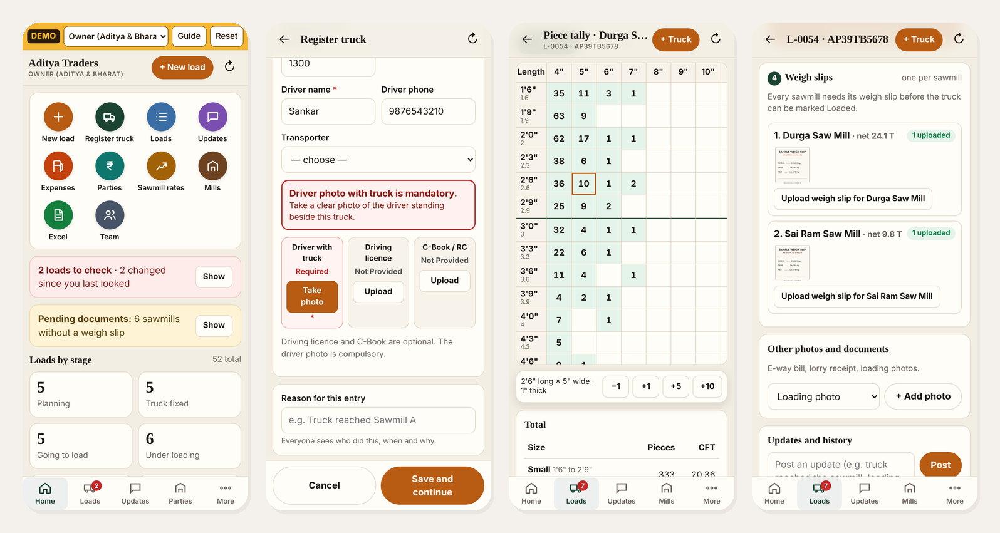

## Links

| | |
|---|---|
| **Live app**: owner, accountant and staff sign in here | https://krishnasai-pentakota.github.io/aditya/ |
| **Demo**: the same app with sample data, no sign-in; switch between owner, accountant and staff at the top | https://krishnasai-pentakota.github.io/aditya/demo/ |
| **Walkthrough**: every stage, screen by screen | https://krishnasai-pentakota.github.io/aditya/demo/guide.html |

## The problem

- **One truck, several sawmills.** A 30 or 35-ton truck often takes its load from two or three sawmills. Each sawmill has its own wood, sizes, quantities and weigh slip, but it is still one trip.
- **Counting on paper.** At the sawmill, staff count sawn pieces on a paper grid (length × width), and someone later types the counts into an Excel workbook that works out the CFT.
- **Money is private.** Freight, sawmill rates, bills and payments must stay with the owner and the accountant, and never reach the staff's phones.
- **Changes go unnoticed.** A truck's details change many times a day. The accountant checks every day and must see what changed without being told.

## What it does

- **Loads and stages:** Planning → Truck fixed → Going to load → Under loading → Loaded → In transit → Delivered, then the bill moves through Ready to bill → Billed → Payment pending → Paid.
- **Register a truck:** truck number, capacity (tons and CFT) and driver. A **photo of the driver beside the truck is compulsory**: without it a red warning shows and nothing is saved. The driving licence and C-Book are optional and show "Not Provided" when missing.
- **Sawmills and wood items:** add any number of sawmills to one truck, and any number of wood items to each sawmill (wood type, Small / Medium / Large, quantity, unit). Units are never mixed (CFT, CBM, RFT, SFT, Tons, Pieces).
- **Arrival and loading:** Under loading starts only when the truck reaches a sawmill. "Loading done here" takes that sawmill's weigh slip, and the truck can't be marked Loaded until every sawmill has one.
- **Piece tally:** a phone version of the paper grid. The database works out CFT exactly as the owner's Excel workbook does, and splits it into Small, Medium and Large (details below).
- **Loading PDF for staff:** *TRUCK LOADING / DISPATCH DETAILS*, with the columns Sl. No. · Saw Mill Name · Name of Product · Size · Quantity · Unit. It contains no rates, amounts, GST, freight or bank details.
- **Owner's money:**
  - Sawmill rate cards (Small / Medium / Large per unit, from a date) keep their full history. A new rate never changes past loads.
  - Purchase rate on each wood item.
  - Freight and charges by category (Truck Freight, Fuel, Toll, Hamali / Loading, Unloading, Weighbridge Charges, Other), with receipt photos.
- **Accountant:** creates bills (invoice, GST amount, credit days), records payments from buyers and to sawmills and transporters, and sees balances.
- **Who changed what:**
  - Every change keeps the person, the exact time, the reason, and the stage at that moment.
  - Each person has their own "checked" mark, so anything changed since they last looked shows in red.
  - Nobody can edit or delete the history.
- **Also:** an "Ask location" WhatsApp message to the driver, an Excel export (one sheet per kind of record, money sheets only for money users), and the team, permissions and settings screens.

## Who sees what

Aditya and Bharat share **one owner login**. The rules are enforced **inside the database** (row-level security, triggers and per-person permission flags), not just on the screen: money is never sent to a staff phone.

| | Owner | Accountant | Staff |
|---|:---:|:---:|:---:|
| Planning and Truck fixed | ✓ | | never |
| Register trucks, sawmills, wood items, tallies, weigh slips, loading PDF | ✓ | ✓ | ✓ |
| Enter sawmill rates and item rates | ✓ | view only | never |
| Enter freight and other charges, receipts | ✓ | view only | never |
| Bills, payments, balances | ✓ | ✓ | never |
| Money entries in the history | ✓ | ✓ | never |
| Team, permissions, settings | ✓ | | |

## Piece tally: how CFT is worked out

The formula comes straight from the owner's Excel workbook:

> **CFT = thickness (in) × width (in) × length (ft) × pieces ÷ 144**  ·  CBM = CFT ÷ 35.3147

- **Grid:** thickness 1", 1.5" or 2". Lengths run 1'6" to 8'6" in 3-inch steps, written the paper way (so "2.3" means 2 ft 3 in). Widths run 4" to 11". The grid size can be changed in Settings.
- **Sizes for every wood:** Small 1'6"–2'9", Medium 3'0"–4'9", Large 5'0" and up.
- **Rounding:** none inside the calculation. Totals are shown to 2 decimals.
- **Checked against the workbook:** typing the workbook's counts into the app gives the same figures to the cent. One sheet comes to 36.91 CFT and 477 pieces. The whole truck comes to **1,350.00 CFT (38.23 CBM) and 8,245 pieces**: Small 621.46, Medium 646.25 and Large 82.29 CFT.
- **Workbook mistakes not copied:** in the workbook, 1-inch pieces 9 ft or longer were calculated as 1.5 inch, and 3-inch widths were left out of the piece count. The app does neither.

More in [docs/CFT_TALLY.md](docs/CFT_TALLY.md).

## Screenshots

All screenshots use the demo's sample data.

**Owner**

| | | |
|:---:|:---:|:---:|
| 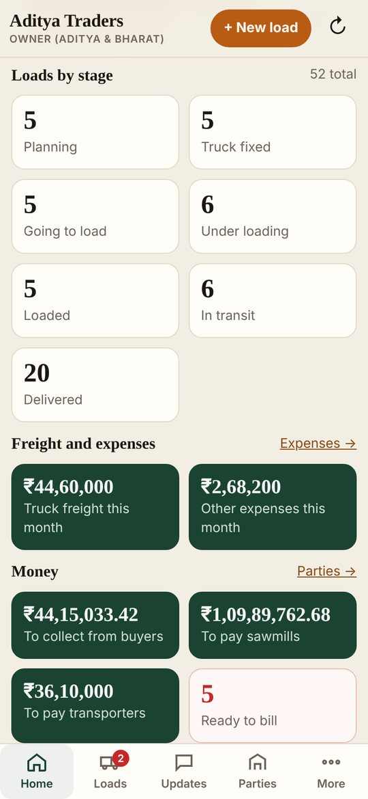 | 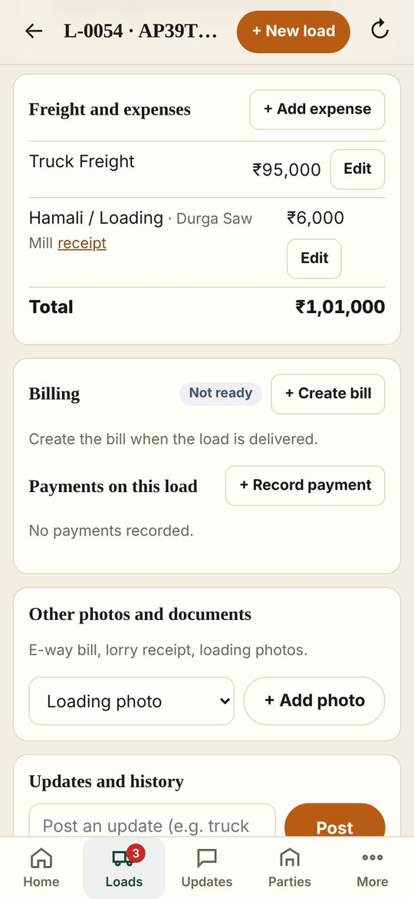 | 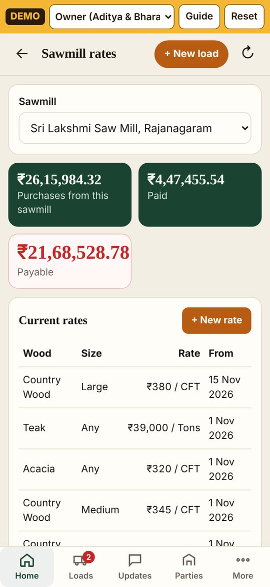 |
| Dashboard: stages, freight, money to collect and pay | Freight and charges on a truck | Sawmill rate cards |
| 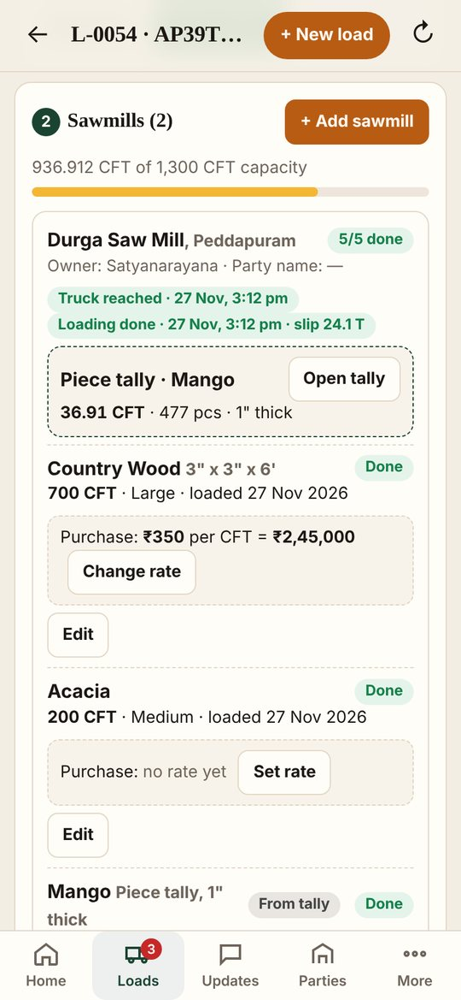 | 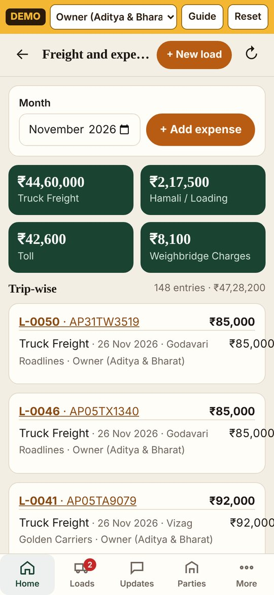 | 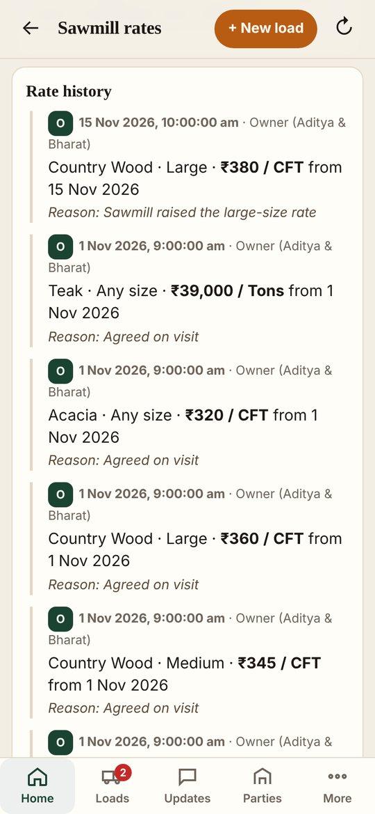 |
| Rate on each wood item | Expenses for the month | Rate history: old rates are kept |

**Staff**

| | | |
|:---:|:---:|:---:|
| 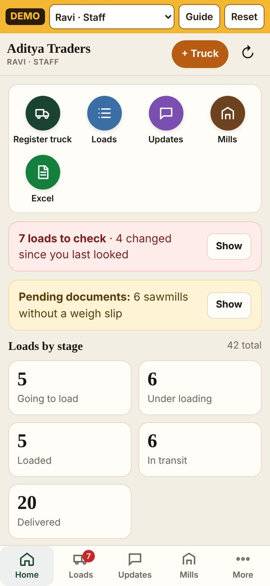 | 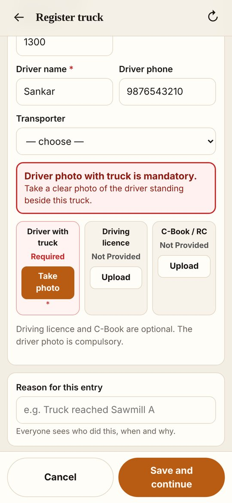 | 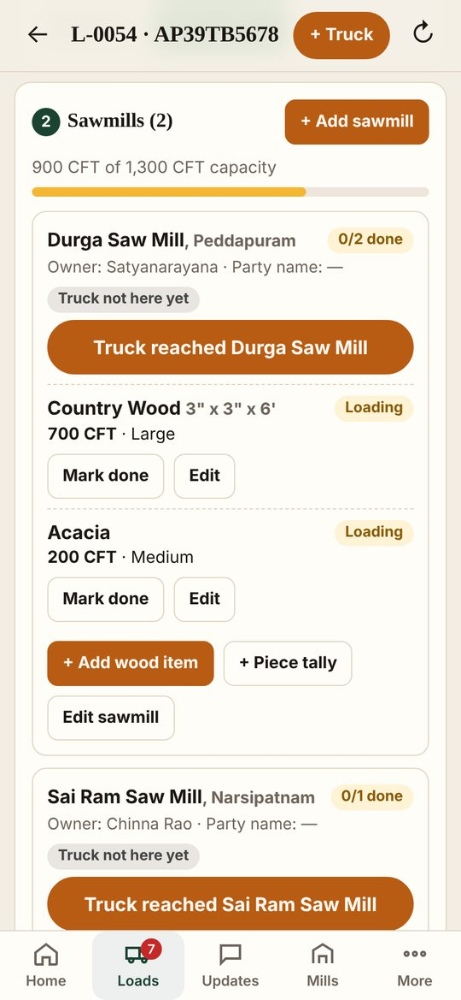 |
| Home: no Planning, no money | Driver photo is compulsory | Two sawmills, three wood items |
| 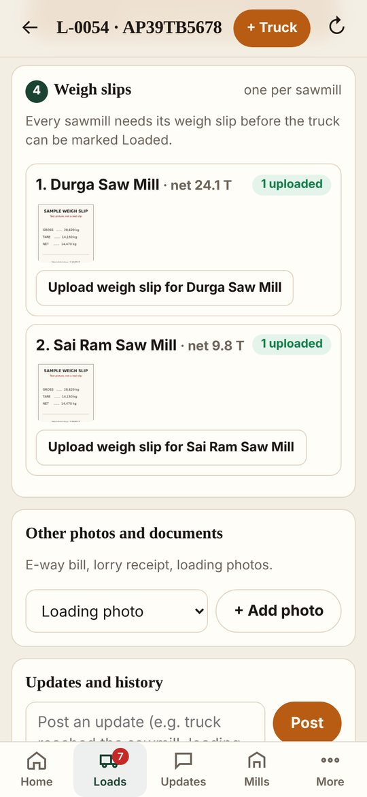 | 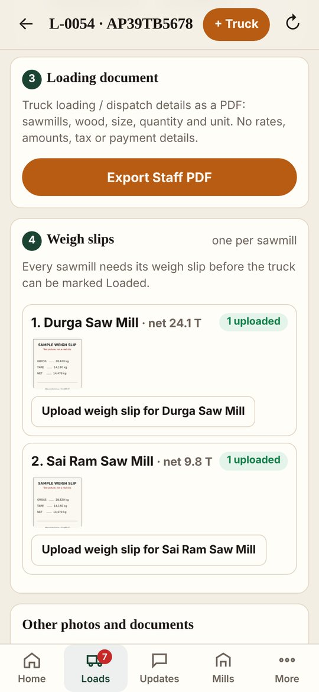 | 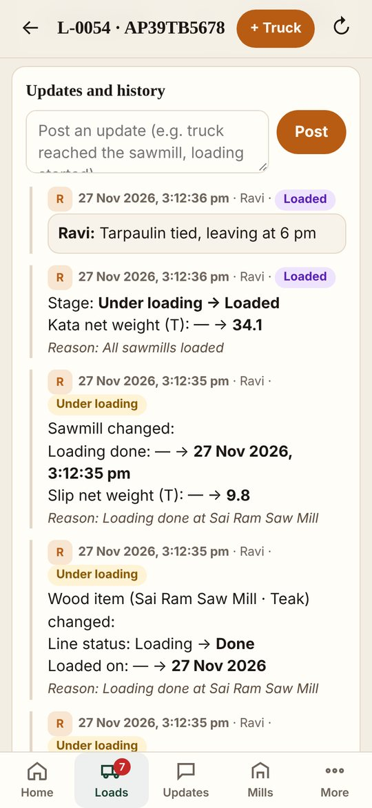 |
| A weigh slip per sawmill | Loading PDF | History without money |

**Piece tally and accountant**

| | | |
|:---:|:---:|:---:|
| 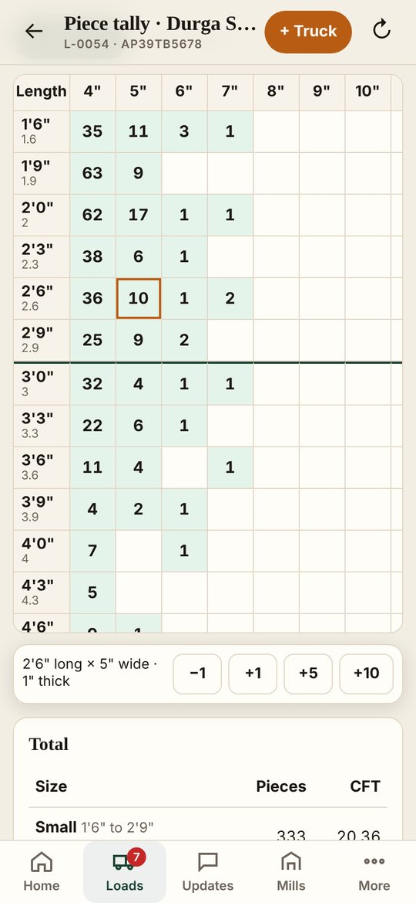 | 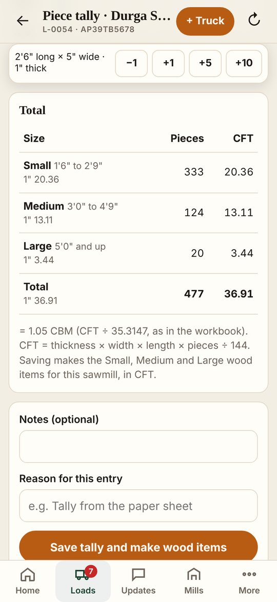 | 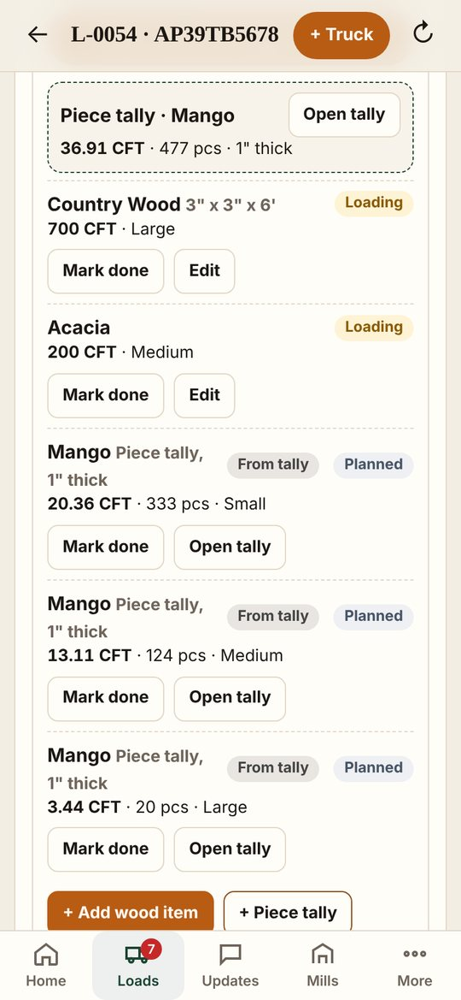 |
| Tally grid, as on paper | Totals by size and thickness | Small / Medium / Large items from the tally |
| 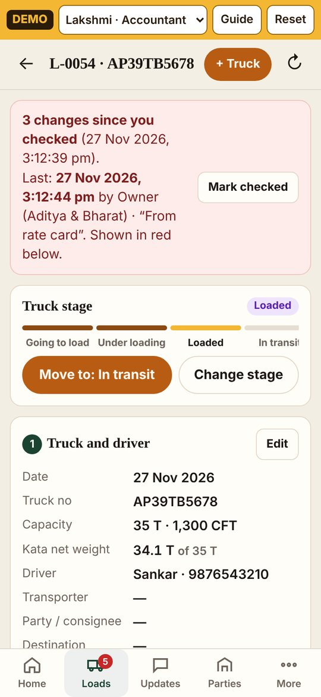 | 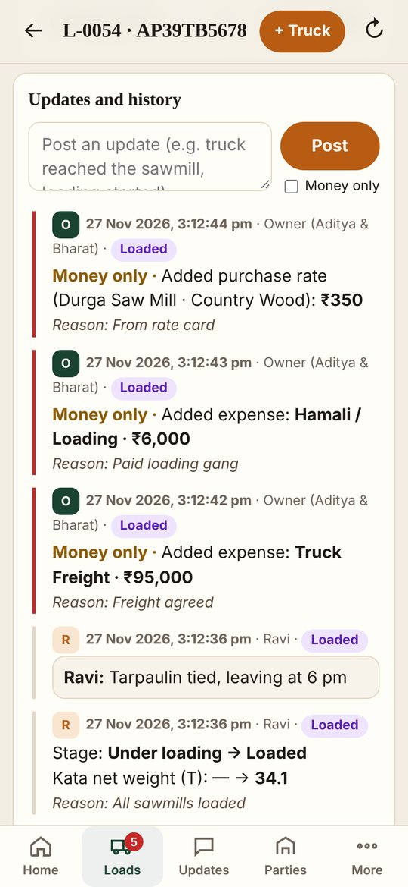 | 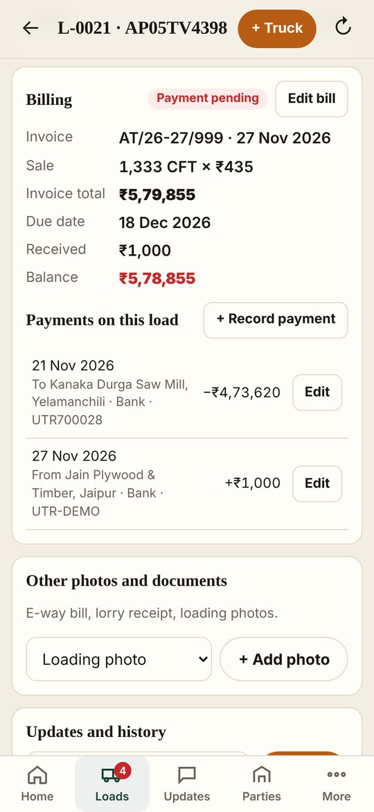 |
| Changes since she last looked | Who, when, what, why | Bill and part payment |

**Loading PDF (no money in it)**

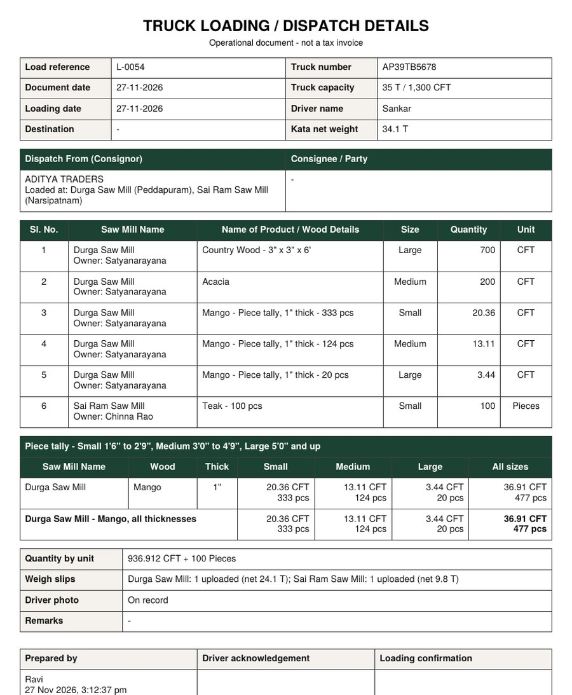

## How it is built

| Part | What |
|---|---|
| App | One HTML file ([app/index.html](app/index.html)): plain JavaScript and CSS, phone-first, no build step. Uses supabase-js, plus jsPDF and SheetJS (loaded only when a PDF or Excel file is made). |
| Database | Supabase Postgres ([supabase/schema.sql](supabase/schema.sql)). The rules live in the database: row-level security on every table, per-person permission flags (`plan`, `finance`, `rates`, `expenses`, `people`), triggers for stage rules, the CFT calculation and history, and views that return blank money columns to staff. |
| Files | Supabase Storage, private bucket. Expense receipts can only be opened by money users. |
| Logins | Supabase Auth. Staff sign in with their phone number. The [team-admin](supabase/functions/team-admin/index.ts) Edge Function lets the owner create logins and reset passwords without exposing the service key. |
| Demo | The real app page with an in-browser stand-in for the database ([demo/demo_backend.js](demo/demo_backend.js)) that copies the same rules. The sample data is made by running every step through the real database as the owner, the accountant and 10 staff. |

## Tests

| Suite | Checks | What it proves |
|---|---:|---|
| [tests/db/test_db_v3.py](tests/db/test_db_v3.py) | 130 | Each person's rights, run as that person (staff get no money, Planning or receipts), stage rules, driver photo, weigh slips, rate history, history and red flags |
| [tests/db/test_db_tally.py](tests/db/test_db_tally.py) | 51 | Piece tally against the owner's workbook counts (1,350.00 CFT), size bands, locks after Loaded, who can see tallies |
| [tests/e2e/test_app_v3.py](tests/e2e/test_app_v3.py) | 59 | The real page in Chrome at phone size: the 10 acceptance tests of the requirements, PDF text, an API leak probe as staff, two devices |
| [tests/e2e/test_app_tally.py](tests/e2e/test_app_tally.py) | 33 | Tally screen, totals, PDF and Excel output, history wording |
| [demo/test_demo.py](demo/test_demo.py) | 48 | The demo page, the screenshots above and the walkthrough |

**Running the tests.** You need PostgreSQL 16, Python 3.11+, Google Chrome and Node (npm):

```bash
pip install -r tests/requirements.txt   # uses your installed Chrome (TT_CHROME to point at it)
bash tests/fetch_vendor.sh            # browser libraries the app loads from its CDNs
# Postgres on socket /tmp, port 54329 by default (PGHOST / PGPORT / TT_DSN to change)
python tests/db/test_db_v3.py && python tests/db/test_db_tally.py
python tests/e2e/test_app_v3.py && python tests/e2e/test_app_tally.py
```

Each suite rebuilds a local database from `supabase/schema.sql`, using a small stand-in for Supabase's `auth` and `storage` schemas ([tests/db/00_supabase_shim.sql](tests/db/00_supabase_shim.sql)).

## Running your own copy

1. Create a Supabase project. In the SQL Editor, run [supabase/schema.sql](supabase/schema.sql).
2. Deploy [supabase/functions/team-admin](supabase/functions/team-admin/index.ts) with JWT verification on.
3. In `app/index.html`, set `SUPABASE_URL` and `SUPABASE_KEY` to your project's URL and anon key. Then serve the file from any static host.
4. Add the first user in Supabase → Authentication. The first login becomes the owner, and the owner adds everyone else from More → Team.

## How the project went

| Date (2026) | Version | What changed |
|---|---|---|
| 23 Nov | Spec | Field interviews: how wood is counted, tallied and loaded. The first calculation and process spec. |
| 24 Nov | 1.0–1.3 | First live app after the owner's call: lorry trips, one shared database, per-person red "edited" flags. Then cost rules for the accountant, photos on each lorry, owner-only prices. |
| 25 Nov | 1.4 | Exact time and status on every change; invoice and e-way bill numbers. |
| 26 Nov | 2.0–2.1 | Loads with stages from Planning to Delivered, sawmill lines, billing, payments, balances and one history. Demo with sample data and the walkthrough. Kata net weight, Ask location, new look. |
| 26 Nov | 3.0–3.2 | Full requirements: permissions enforced in the database, one owner login, sawmills with several wood items, compulsory driver photo, Under loading on arrival, a weigh slip per sawmill, the staff PDF, rate cards with history, freight and expenses. |
| 26 Nov | 3.3 | Piece tally from the owner's Excel workbook, with sizes for every wood. |
| 27 Nov | Live | Database update and login service deployed, checked on the live database, trial logins for the owner, accountant and staff. |

Design notes: [docs/DESIGN.md](docs/DESIGN.md).

## Still to confirm with the owner

- **Loading PDF:** HSN, GSTIN, e-way bill number, driver photo, receiver signature.
- **Weigh slips:** which weights to record, and whether a separate final slip for the whole truck is needed.
- **Rates:** whether each wood is priced per CFT, CBM, ton or piece.
- **Shared charges:** how freight is split between sawmills.
- **Corrections:** whether staff may change entries after a truck is Loaded.
- **Thickness:** whether other thicknesses are bought besides 1", 1.5" and 2".
- **Later:** a cleaned-up Excel tally template for the sawmills.

## Repository layout

```
app/index.html                   the app (same file as the live site)
supabase/schema.sql              the whole database, version 3.3
supabase/functions/team-admin/   login service (Edge Function)
demo/                            in-browser demo backend, sample-data maker, demo and walkthrough builders
tests/                           database and browser tests, shared settings, Supabase stand-in
docs/                            design notes, CFT tally notes, screenshots
```

---

© 2026 Krishna Sai Pentakota. Built for Aditya Traders and shared as a portfolio project. All names, sawmills, parties, rates and amounts in the demo and screenshots are invented sample values.
